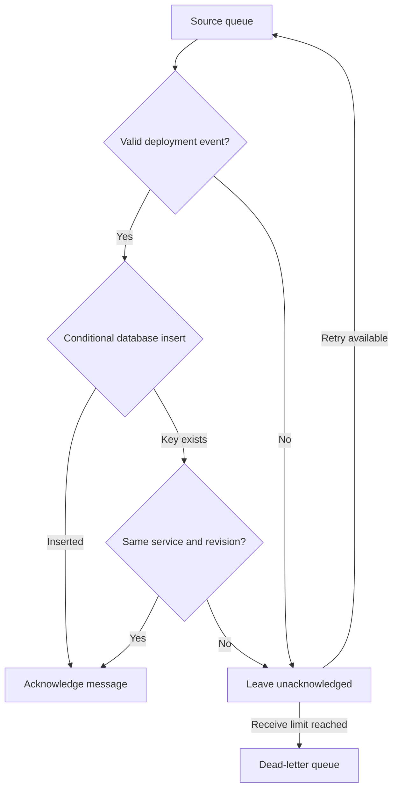

# An SQS worker that can safely process a deployment event twice

A worker records a deployment, then crashes before it can acknowledge the queue message. Another worker receives the same event. Should it write another record, skip it, or tell someone the data conflicts?

This lab uses Python, Boto3, an SQS-compatible queue (ElasticMQ), and DynamoDB Local. It runs inside GitHub Actions or on a laptop, with synthetic deployment events and loopback-only endpoints. No AWS account is required.

## How the worker decides

Each event contains a business `event_id`, a `service`, and a `revision`. Eight separately sent messages can have eight transport IDs and still describe the same deployment. The worker keys the ledger by the business ID.



The conditional insert makes the decision atomic even when several workers compete for the same key. On a key collision, a strongly consistent read distinguishes an identical replay from two events that incorrectly share an ID. Other database errors propagate and leave the receipt unacknowledged.

## What the drill exercises

| Scenario | Passing condition |
| --- | --- |
| Crash after writing | Interrupt the actual acknowledgement call, wait for visibility to expire, and receive the same SQS message again. Its record already exists and the retry acknowledges it. |
| Eight concurrent deliveries | Send eight separate messages with one business ID. Release eight worker threads together. Exactly one conditional insert succeeds and seven identical replays are acknowledged. |
| Conflicting ID and malformed input | Deliver one changed revision for an existing ID and one event missing its revision. The queue moves both messages to its dead-letter queue after three source deliveries each. |
| Selective replay | Supply the missing revision from the synthetic fixture and requeue that message. Remove its dead-letter copy after the new write succeeds. Leave the conflicting event available for review. |
| Final state | Read the entire small ledger and compare each field against the three expected deployment records. |

## Run it

Use Python 3.12 and Docker Compose. From the repository root, run these commands in Bash.

```bash
cd labs/sqs-idempotent-worker
python -m venv .venv
. .venv/bin/activate
python -m pip install -r requirements.txt
python -m unittest -v test_worker
docker compose up -d
python drill.py
docker compose down -v
```

The drill waits for both services, creates unique resource names for each run, and removes its own table and queues on exit. Docker exposes the queues at `127.0.0.1:9324` and the database at `127.0.0.1:8000`. The one-second visibility timeout makes crash recovery easy to observe in a short lab.

## Operational scope

The durable effect tested here is one DynamoDB ledger entry per deployment ID. Adding a second effect such as publishing a notification would need its own idempotency mechanism or a transactional outbox. Real AWS testing would also need to cover IAM permissions, service limits, and visibility timeouts sized for actual processing time.

[Worker implementation](worker.py) · [Integration drill](drill.py) · [GitHub Actions workflow](../../.github/workflows/sqs-idempotency.yml) · [AWS SQS dead-letter queues](https://docs.aws.amazon.com/AWSSimpleQueueService/latest/SQSDeveloperGuide/sqs-dead-letter-queues.html) · [DynamoDB conditional writes](https://docs.aws.amazon.com/amazondynamodb/latest/developerguide/Expressions.ConditionExpressions.html)
